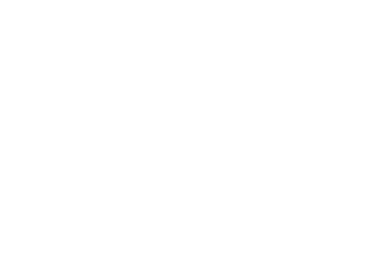

<strong>Renz Diaz</strong> 
<a href="mailto:renzdiaz.contact@gmail.com">renzdiaz.contact@gmail.com</a> · PeenoiseDev

---

### About me

I'm a full-stack developer who enjoys building useful, easy-to-use web applications. I work with **Laravel, PHP, Vue.js, Next.js, TypeScript, and databases**, and I like turning ideas into websites that work well on any device.

- **Building:** Websites and tools for businesses, schools, and teams
- **Interested in:** Clear designs and simple, helpful interactions
- **How I work:** I value secure, reliable software and code that's easy to maintain
- **Education:** BS in Information Technology, Universidad de Manila

### Tech stack

A few of the tools I use to build, design, and ship web projects.

<table>
<tr>
<td width="50%" valign="top">

<strong>Frontend</strong>  
 

</td>
<td width="50%" valign="top">

<strong>Backend &amp; data</strong>  

</td>
</tr>
<tr>
<td width="50%" valign="top">

<strong>Tools</strong>  

</td>
<td width="50%" valign="top">

<strong>Cloud &amp; collaboration</strong>  

 
AWS Lightsail · Amazon EC2

</td>
</tr>
</table>

### Selected work

  <em>A few projects I’ve worked on and enjoyed building.</em>

<table>
<tr>
<td width="50%" valign="top">

### [CSNK-V2.2](https://github.com/Znerzi/CSNK-V2.2)
<em>Vue-based application</em>

> A frontend project built with Vue.js.

**Highlights**
- Built with Vue.js
- Focused on frontend development
- [Explore the source code on GitHub](https://github.com/Znerzi/CSNK-V2.2)

</td>
<td width="50%" valign="top">

### WebiMix
<em>Webinar hosting and management</em>

> A place for hosts to publish webinars and manage the attendee experience.

**Highlights**
- Publish webinars and manage registrations
- Share certificates and learning materials
- Easy-to-use pages for hosts and attendees

</td>
</tr>
<tr>
<td width="50%" valign="top">

### MerlArchive
<em>Academic research repository</em>

> An online collection of academic research for the Universidad de Manila community.

**Highlights**
- Search and filter research papers
- Submit papers and manage reviews
- Pages for students and librarians

</td>
<td width="50%" valign="top">

### Personal Portfolio
<em>Developer website and design explorations</em>

> My website for sharing projects and trying out new design ideas.

**Highlights**
- Improve the look and feel of the website
- Make it work well on phones and computers
- Keep pages clear and easy to navigate

</td>
</tr>
</table>

### Public repositories

Some of the projects and technologies I’ve been exploring:

<table>
<tr>
<td width="50%" valign="top">

#### [CSNK-V2.2](https://github.com/Znerzi/CSNK-V2.2)
Vue-based application

</td>
<td width="50%" valign="top">

#### [LaraNext](https://github.com/Znerzi/LaraNext)
Laravel and Blade development

</td>
</tr>
<tr>
<td width="50%" valign="top">

#### [Ionic](https://github.com/Znerzi/Ionic)
TypeScript mobile development

</td>
<td width="50%" valign="top">

#### [R_OneClickShop](https://github.com/Znerzi/R_OneClickShop)
E-commerce web project

</td>
</tr>
</table>

### GitHub activity

**Follow along with my work and contributions**

[View my GitHub profile and contribution calendar →](https://github.com/Znerzi)

Contribution history and achievements are shown on my GitHub profile. This keeps the section useful even when third-party stats services are unavailable.

---

### Have a project in mind?

I'd love to hear what you're building. Let's make something useful together.

Designed for GitHub's dark appearance · Updated 2026

