

 

<!-- ============================ ABOUT ============================ -->


I'm a full-stack developer who enjoys building useful, easy-to-use web applications. 
I work with <strong>Laravel, PHP, Vue.js, Next.js, TypeScript, and databases</strong>, 
and I like turning ideas into responsive websites.


 

<!-- ============================ TECH STACK ============================ -->


<table width="100%">
  <tr>
    <td width="50%" valign="top">
      
      

        <picture>
          <source media="(prefers-color-scheme: dark)" srcset="https://skillicons.dev/icons?i=vue,nextjs,react,ts,js,tailwind,html,css&theme=dark" />
          <source media="(prefers-color-scheme: light)" srcset="https://skillicons.dev/icons?i=vue,nextjs,react,ts,js,tailwind,html,css&theme=light" />
          
        </picture>
      

    </td>
    <td width="50%" valign="top">
      
      

        <picture>
          <source media="(prefers-color-scheme: dark)" srcset="https://skillicons.dev/icons?i=laravel,php,nodejs,mysql,postgres,supabase&theme=dark" />
          <source media="(prefers-color-scheme: light)" srcset="https://skillicons.dev/icons?i=laravel,php,nodejs,mysql,postgres,supabase&theme=light" />
          
        </picture>
      

    </td>
  </tr>
  <tr>
    <td width="50%" valign="top">
      
      

        <picture>
          <source media="(prefers-color-scheme: dark)" srcset="https://skillicons.dev/icons?i=git,github,vscode,figma,postman,vercel&theme=dark" />
          <source media="(prefers-color-scheme: light)" srcset="https://skillicons.dev/icons?i=git,github,vscode,figma,postman,vercel&theme=light" />
          
        </picture>
      

    </td>
    <td width="50%" valign="top">
      
      

        <picture>
          <source media="(prefers-color-scheme: dark)" srcset="https://skillicons.dev/icons?i=aws,bitbucket&theme=dark" />
          <source media="(prefers-color-scheme: light)" srcset="https://skillicons.dev/icons?i=aws,bitbucket&theme=light" />
          
        </picture>
        
        
        
      

    </td>
  </tr>
  <tr>
    <td width="50%" valign="top">
      
      

        
        
        
      

    </td>
    <td width="50%" valign="top">
      
      

        <picture>
          <source media="(prefers-color-scheme: dark)" srcset="https://skillicons.dev/icons?i=laravel&theme=dark" />
          <source media="(prefers-color-scheme: light)" srcset="https://skillicons.dev/icons?i=laravel&theme=light" />
          
        </picture>
        
        
        
        
        
      

    </td>
  </tr>
</table>

 

<!-- ============================ SELECTED WORK ============================ -->


<a href="https://github.com/Znerzi/CSNK-V2.2">
  
</a>




 

<!-- ============================ GITHUB ACTIVITY ============================ -->


  <a href="https://github.com/Znerzi?tab=repositories"></a>
  <a href="https://github.com/Znerzi"></a>
  <a href="https://github.com/Znerzi?tab=followers"></a>

 

<!-- ============================ CONTACT ============================ -->


  
  
  

